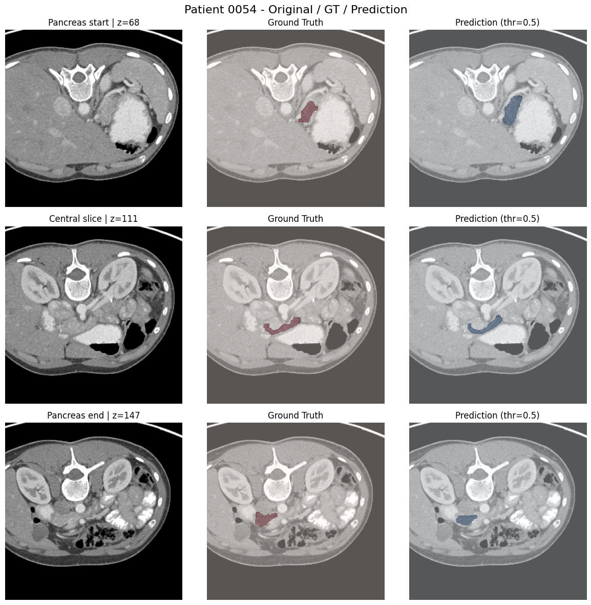
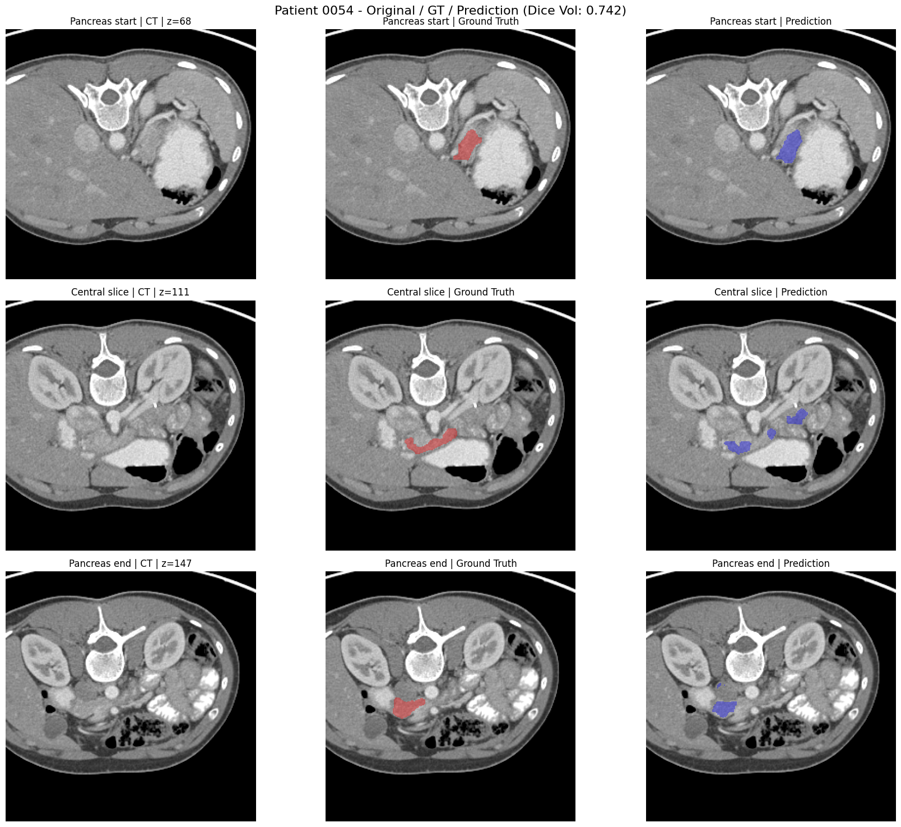

# Pancreas Segmentation CT scans Project 
<p align="center">30 March 2026</p>


## Overview

The **exam project** for the course *"Artificial Intelligence – Module 2"*, held by **Professor Andrea Tangherloni** and **Professor Federico Borra** (A.Y. 2025/2026) in the **[LM] Data Science, Data Analytics and Artificial Intelligence in Health Sciences** master's degree program.

---

## Description
This project addresses **automatic pancreas segmentation** from abdominal CT scans, a challenging task due to the small size, variable shape, and low contrast of the pancreas.

The dataset comes from the public **[Pancreas-CT collection](https://www.cancerimagingarchive.net/collection/pancreas-ct/)** (The Cancer Imaging Archive), comprising 82 contrast-enhanced 3D CT volumes with manually annotated pancreas masks.

We systematically compare multiple segmentation architectures across **2D** (slice-by-slice U-Net variants and a ResNet baseline) and **3D** (volumetric U-Net and Swin UNETR) approaches. The pipeline includes exploratory data analysis, preprocessing (resampling, intensity clipping and normalization, fixed-field cropping), training with different loss functions and schedulers, and a sanity check to validate the training pipeline.

The best results are achieved by the **Fourth U-Net 2D** (BCE + Tversky loss, Dice 3D = 0.8317) and the **Second Swin UNETR 3D** (Dice Focal loss, Dice = 0.8163) on the validation set.

---

## Project Pipeline

### 1. Exploratory Data Analysis (EDA)
- Notebook: `eda.ipynb`  

The following analyses were performed:

I. Pancreas spatial distribution across CT slices  
II. Distribution of pancreas volume  
III. Distribution of voxel spacing (dx, dy, dz)  
IV. Hounsfield Unit (HU) distribution: pancreas vs background  
V. 2D spatial occupancy heatmap of pancreas location  

---

### 2. Preprocessing
- Notebook: `preprocessing.ipynb`  

The preprocessing pipeline includes:

I. Resampling of CT scans and masks  
II. Intensity clipping  
III. Intensity normalization  
IV. Fixed field cropping  

---

### 3. Final Dataset

The original dataset comes from the **[Pancreas-CT collection](https://www.cancerimagingarchive.net/collection/pancreas-ct/)** available through **The Cancer Imaging Archive (TCIA)**.

The original data were converted from **`.pt` to `.nii` format**, then preprocessed and reorganized into patient-level training, validation, and test subsets.

- **Train:** 58 patients
- **Validation:** 10 patients
- **Test:** 12 patients

The preprocessing pipeline generates the following directory structure:

```text
dataset_split_1303/
├── train/
│   ├── ct/
│   └── mask/
├── val/
│   ├── ct/
│   └── mask/
└── test/
    ├── ct/
    └── mask/
```
> **Note:** The processed dataset (~1 GB) is not included in this repository due to its size. It can be reconstructed from the original Pancreas-CT dataset using the provided preprocessing pipeline.


---

### 4. Models

#### 2D Models

- **Baseline ResNet** — ResNet34 encoder–decoder without skip connections, trained with BCE + Dice loss.
- **First U-Net** — baseline U-Net trained with BCE + Dice loss.
- **Second U-Net** — U-Net with data augmentation, One Cycle LR, and gradient clipping.
- **Third U-Net (Sanity Check)** — shuffled-label experiment used to verify the training pipeline and detect potential data leakage.
- **Fourth U-Net** — improved U-Net trained with BCE + Tversky loss.

#### 3D Models

- **First U-Net 3D** — baseline volumetric U-Net trained with Dice loss.
- **Second U-Net 3D** — improved U-Net with MONAI augmentation, One Cycle LR, and Dice Focal loss.
- **First Swin UNETR** — transformer-based 3D architecture trained with Dice + Cross Entropy loss.
- **Second Swin UNETR** — Swin UNETR trained with Dice Focal loss and One Cycle LR.


---

## 5. Visualization

### Model Output
Trained model results are saved in **Parquet** format.

### Visualization Notebooks
- 2D: `visualization_output_2d.ipynb`
- 3D: `visualization_output_3d.ipynb`

Each visualization notebook loads the best checkpoint for every trained model and produces a **3-slice comparison** on a test patient (Patient 0054):
- **Start slice** → first slice where pancreas area ≥ 20% of the maximum
- **Central slice** → slice at the midpoint among all slices containing pancreas
- **End slice** → last slice where pancreas area ≥ 20% of the maximum

For each slice, three panels are shown side by side: the **original CT**, the **Ground Truth** mask overlay, and the **model Prediction** overlay.

---

## 6. Results

### 6.1 2D Models — Summary

| Model | Loss | Best Epoch | Dice 2D (val) | Dice 3D (val) |
|---|---|---|---|---|
| Baseline ResNet | BCE + Dice | 7 | 0.8018 | 0.6432 ± 0.0731 |
| First U-Net (Baseline) | BCE + Dice | 42 | 0.8656 | — |
| Second U-Net | BCE + Dice | 40 | 0.8404 | 0.8304 ± 0.0269 |
| Third U-Net (Sanity — normal) | BCE + Dice | 18 | 0.8576 | 0.7970 ± 0.0356 |
| Third U-Net (Sanity — shuffled) | BCE + Dice | 1 | 0.6016 | 0.0000 ± 0.0000 |
| **Fourth U-Net** ⭐ | **BCE + Tversky** | **44** | **0.8558** | **0.8317 ± 0.0277** |

> **Best 2D model:** Fourth U-Net with BCE + Tversky loss (α=0.3, β=0.7), achieving a volumetric Dice of **0.8317** on the validation set.

### 6.2 3D Models — Summary

| Model | Loss | Best Epoch | Dice (val) |
|---|---|---|---|
| First U-Net 3D | Dice | 95 | 0.1734 |
| Second U-Net 3D | Dice Focal | 93 | 0.5603 |
| First Swin UNETR | Dice + CE | 41 | 0.6189 |
| **Second Swin UNETR** ⭐ | **Dice Focal** | **85** | **0.8163** |

> **Best 3D model:** Second Swin UNETR with Dice Focal loss and One Cycle LR scheduler, achieving a Dice of **0.8163** on the validation set.

### 6.3 Best Model Visualizations

The following visualizations show the segmentation output on **Patient 0054** (test set) for the best 2D and 3D models.

#### Best 2D — Fourth U-Net (BCE + Tversky)



#### Best 3D — Second Swin UNETR (Dice Focal)



---

## 7. Project Structure
```text
Pancreas Segmentation CT scans_Project /
│
├── eda.ipynb
├── preprocessing.ipynb
│
├── dataset_split_1303/
│   ├── train/
│   │   ├── ct/
│   │   └── mask/
│   ├── val/
│   │   ├── ct/
│   │   └── mask/
│   └── test/
│       ├── ct/
│       └── mask/
│
├── models_2d/
│   ├── models/
│   │   ├── first_unet.py
│   │   ├── second_unet.py
│   │   ├── third_unet_sanity.py
│   │   ├── fourth_unet.py
│   │   └── baseline_resnet.py
│   │
│   └── outputs/
│       ├── first_unet_output.txt
│       ├── second_unet_output.txt
│       ├── third_unet_sanity_output.txt
│       ├── fourth_unet_output.txt
│       └── baseline_resnet_output.txt
│
├── models_3d/
│   ├── models/
│   │   ├── first_unet3d.py
│   │   ├── second_unet3d.py
│   │   ├── first_swinunetr.py
│   │   └── second_swinunetr.py
│   │
│   └── outputs/
│       ├── first_unet3d.txt
│       ├── second_unet3d.txt
│       ├── first_swinunetr.txt
│       └── second_swinunetr.txt
│
├── visualization_output_2d.ipynb
├── visualization_output_3d.ipynb
├── visualization_images/
│
├── requirements.txt
└── README.md
```